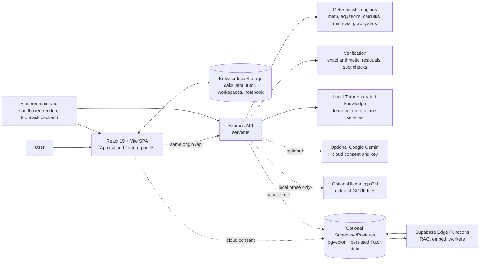

# Calcora AI — Project Intelligence, Technical Audit & Folder Inventory

**Audit date:** 2026-10-18  
**Project path:** `E:\Calcora-AI-production`  
**Report location:** `E:\Calcora-AI-production\report.md`  
**Method:** Read-only source/configuration inspection, static package and ASAR inspection, read-only Git inspection, folder inventories, and selected safe checks.  
**Scope caveat:** This is not a security certification, complete test run, package launch, cloud integration check, or llama.cpp inference benchmark.

> **Safety and provenance.** Before this report was created, the production tree already had 138 Git status entries (31 staged, 67 unstaged, 56 untracked; counts overlap). No existing project file, source, configuration, model, build, or Git state was changed by the audit. This requested documentation file is the only new file created in the repository. No package was installed, no build/migration/production service was run, no app installer or llama.cpp executable was launched, no model inference was performed, and no Git fetch/pull/push/reset/clean/stash/checkout was performed. Secrets and credentials were not printed.

## 1. Executive summary

Calcora AI is a TypeScript/React scientific calculator and mathematics workbench. The application combines deterministic math engines, an Express API, an optional Gemini explanation path, optional Supabase persistence/RAG, and an Electron desktop wrapper. Source code expresses a useful safety principle: deterministic math is authoritative; AI text may explain results but should not replace them. That principle is well represented in the Tutor and local-model flows, but the audit found a concrete arithmetic verification design gap described in finding F-02.

The only complete source checkout inspected is `E:\Calcora-AI-production`. It is heavily modified: at audit start there were 138 staged, unstaged, and untracked Git status entries. The local `main` commit and cached `origin/main` ref both point to `91b57c5`; this does not establish the live remote head. The configured remote is for `mahnoorfaisal-kogents/Calcora-AI`, not the public URL requested in the audit, and its remote refs could not be read. The requested public repo `mali123456-del/Calcora-AI` has one commit adding only a one-line README, so it is not the application’s source repository.

Of the three Windows packages, `E:\calcora-build-latest` is the strongest **package candidate** based on measurable correspondence: its server bundle and all 119 packaged renderer assets match the current generated `dist` outputs. `E:\calcora-build-next` has the same server/Electron main/preload bundles but a different renderer build; `E:\calcora-build` is older and differs in both server and renderer. None was launched, so none is runtime-certified by this audit. All three installer signatures read `NotSigned`.

### Current assessment

- **Project status:** Functional and broad source implementation; selected typecheck and focused suites passed. Not a clean or fully released baseline. Full `npm run verify`, build, browser/package smoke, dependency audit, live cloud checks, and real model inference were not performed.
- **Strongest existing build:** `calcora-build-latest` is the best evidence-based package candidate, not a certified release.
- **Highest risks:** unprotected API routes when network-exposed; same-engine arithmetic can report false `PASS`; stale notebook verification after content edits; adaptive learning not wired into the visible practice workflow; local llama.cpp runtime is unavailable to the current app environment.
- **Source modification:** none. The requested `report.md` is documentation; no application code was modified.

## 2. Project purpose and verified capabilities

The README describes Calcora as a deterministic-first calculator and mathematics workbench. The following capabilities are present in source; status details are in section 10.

- Scientific calculator, expression evaluation, history, memory, angle modes and display precision.
- Equation/system solving, calculus operations, matrices, statistics/probability, engineering/programmer calculations, units, finance, formulas and 2D graphing.
- Local Tutor with privacy modes, deterministic context, progressive hints, check-work flows, conversation state and optional Gemini explanations.
- Bounded Math Agent and student-analysis/practice API.
- Optional local GGUF explanation adapter using a llama.cpp CLI.
- Locally parsed, selectable-text PDFs with page-aware context; no OCR for scanned PDFs.
- Browser Web Speech API input with transcript sanitation and explicit math-readiness verdicts.
- Data Lab with bounded CSV/TSV/XLSX parsing, descriptive statistics, linear regression, and JSON export; XLSX imports the first worksheet.
- LocalStorage-based calculator, workspace, Tutor, learner and notebook state; validated export/import helpers.
- Optional Supabase/Postgres and Edge Function components for Tutor persistence, vector/RAG retrieval, embeddings and metadata workers.

No app-level login/register or role system was found. LocalStorage is not encrypted by application code. Supabase is optional and was not live-tested.

## 3. Environment and accessibility

| Target | Access and evidence |
|---|---|
| `E:\Calcora-AI-production` | Accessible full working tree and Git repository. Contains source, tests, docs, installed dependencies, generated output, and four LFS GGUF models. |
| `E:\calcora-build` | Accessible Windows installer/portable package and unpacked Electron app; no source or Git metadata. |
| `E:\calcora-build-latest` | Accessible Windows installer/portable package and unpacked Electron app; no source or Git metadata. |
| `E:\calcora-build-next` | Accessible Windows installer/portable package and unpacked Electron app; no source or Git metadata. |
| `E:\calcora-tools\llama.cpp` | Accessible Windows x64 executables and DLLs only; no source tree, README, CMake files, model files, or `.git`. |
| `https://github.com/mali123456-del/Calcora-AI` | Accessible public metadata; one commit adding a single README line, zero releases/workflows/issues in the returned public metadata. No project source. |
| Local configured Git `origin` | Points to a different owner/repository. Read-only `git ls-remote` returned no refs and exit code 1. No fetch was made. |

Tool environment during inspection: Windows, Node.js `v24.22.0`, npm `11.19.1`, Git `2.56.0.windows.2`. README requires Node 22.12+ and the workflows use Node 22; the scoped checks therefore ran on Node 24, not the documented CI runtime.

Production checkout: branch `main`, `HEAD=91b57c5364432728f4ec6d296dc9e1bfdb66c7ef`, dated `2026-10-06T06:56:00-07:00`, subject `feat: add local AI runtime, knowledge updates, and GGUF models`. The local cached `origin/main` ref points to the same commit (0/0 against that cached ref only). Worktree status at audit start: 138 entries (31 staged, 67 unstaged, 56 untracked, overlapping categories). The report itself adds one untracked documentation file; all prior status entries remain untouched.

### Stack and runtime

- Renderer: React 19, TypeScript 7, Vite 8, Tailwind CSS 4, Lucide React, Motion.
- Backend: Node.js, Express 4, esbuild.
- Desktop: Electron 44, sandboxed BrowserWindow, preload bridge, electron-builder.
- Optional integrations: Google GenAI, Supabase JS/Postgres/Edge Functions, PDF.js, XLSX, browser SpeechRecognition, open.er-api.com exchange-rate feed.
- Configured project requirements: Node 22.12+, npm (`README.md:16-19`).

## 4. Complete folder-by-folder inventory

The tree below includes source, tests, docs, configuration and deployment-related directories. Huge/generated directories (`.git`, `node_modules`, `dist`, `release`, package internals and binary weights) are summarized instead of dumped.

```text
E:\Calcora-AI-production\
├── .env.example                       environment-variable template; no live values audited
├── .git/                              repository metadata; not dumped
├── .gitattributes                     Git/LFS configuration
├── .github/
│   └── workflows/
│       ├── calcora-ci.yml             full verify + Windows package workflow
│       ├── cross-platform.yml         Linux/Windows/macOS verify/package matrix
│       ├── windows-build.yml          Windows build workflow
│       └── windows-release.yml        Windows release workflow
├── .gitignore                         ignores generated output, env, tooling scratch
├── .kilo/                             local agent tooling (not application runtime)
│   ├── agents/data.md
│   └── skills/{adbc,adf-master,agent-md-refactor,airbyte-agent}/
├── .kombai/                           local design tooling; canvas/ and design-systems/
├── .vscode/                           empty in inspected listing
├── CALCORA_FINAL_VERIFICATION_REPORT.md  historical audit report; not reverified here
├── CALCORA_LOCAL_AI_KNOWLEDGE_REPORT.md historical model/report document; not reverified here
├── CALCORA_STATE_REPORT.md            historical Git/state report; not current authority
├── benchmark-results-model-free.json  generated benchmark output
├── build/
│   └── icons/                         generated icon sizes, ICO, ICNS and preview sheet
├── bun.lock                           Bun lockfile; inconsistent with npm manifest (F-11)
├── chat_*.md / *-chat-*.md            ignored local agent/session transcripts
├── control-accessibility-report.json  generated accessibility report
├── desktop.ini                        Windows metadata
├── dist/                              generated Vite renderer + server.cjs + source map
├── dist-electron/                     generated main.cjs and preload.cjs bundles
├── docs/                              technical, security, UI, performance, model, research reports
├── electron/
│   ├── assets/calcora-icon.svg
│   ├── main.ts                        Electron main; starts local backend and BrowserWindow
│   ├── platformPolicy.ts              platform credential/window policy
│   ├── preload.ts                     credential IPC bridge
│   └── runtimeConfig.ts               desktop host/port/key/renderer URL policy
├── freebuff-chat-*.md                 ignored local tooling transcript
├── index.html                         Vite HTML shell
├── metadata.json                      product/build metadata
├── models/                            4 Git-LFS GGUF model files; ~6.44 GB total
├── node_modules/                      installed dependencies; generated, not source
├── package-lock.json                  npm lockfile used by npm/CI
├── package.json                       scripts, dependencies, Electron Builder targets
├── public/assets/aistudio/            public/static-asset namespace, empty/ignore marker
├── release/                           generated release destination; empty at inspection
├── scripts/
│   ├── deletionManifest.ts            model-retirement evidence manifest (not executed)
│   ├── generate-app-icons.mjs         icon generation command (not executed)
│   ├── modelInventory.ts              GGUF metadata inventory utility
│   ├── probe-cross-platform-packaging.ps1
│   ├── run-test-sweep.mjs             test-sweep utility
│   └── runTutorLearningEvaluation.ts  operator evaluation utility; not run
├── server.ts                          Express API, Tutor routing, Vite/static server
├── src/
│   ├── App.tsx                        root state-based panel navigation
│   ├── main.tsx                       React mount
│   ├── types.ts                       domain/API/shared UI types
│   ├── index.css                      visual tokens/styles
│   ├── env.d.ts                       Vite/Electron declarations
│   ├── ai/                            provider client, privacy, models, languages, orchestration
│   ├── components/                    React panels and controls (listed below)
│   ├── data/currencies.ts             currency data
│   ├── engine/                        deterministic math/calculation engines
│   ├── evaluation/tutorBenchmark.ts   Tutor evaluation tooling
│   ├── hooks/                          calculator, keyboard, theme hooks
│   ├── knowledge/                     curated math corpus, retrieval, ingestion, verification
│   ├── learning/                      legacy mastery/mistake stores
│   ├── performance/resourcePolicy.ts  resource limits/policy
│   ├── services/                      API, AI, document, import, learning and persistence services
│   ├── utils/                          Tutor storage, sanitization, speech and export helpers
│   ├── verification/                   exact arithmetic, independent verifier and provenance
│   └── workers/dataAnalysis.worker.ts  worker-thread data analysis
├── supabase/
│   ├── functions/                      Deno Edge Functions
│   └── migrations/                     SQL schema, RLS, vectors, queues and cron setup
├── tests/                              64 *.test.ts files + browser/smoke/benchmark support
├── tools/llama.cpp/                    empty local tools placeholder (distinct from E:\calcora-tools\llama.cpp)
├── tsconfig.json                       no-emit TS check; excludes tests/Supabase/dist
├── vite.config.ts                      React + Tailwind Vite config and alias
└── report.md                           this requested full project report
```

### `src/components/` — all 29 listed files

`AIAssistantPanel.tsx`, `AdvancedMathDashboard.tsx`, `CalculusPanel.tsx`, `CommandCenterHome.tsx`, `CommandPalette.tsx`, `CurrencyConverterPanel.tsx`, `CurrencyConverterWidget.tsx`, `DataAnalysisPanel.tsx`, `DesktopGeminiSettings.tsx`, `DeveloperPanel.tsx`, `Display.tsx`, `EngineeringPanel.tsx`, `EquationSolverPanel.tsx`, `FinanceCalculatorPanel.tsx`, `FormulaLibraryPanel.tsx`, `GraphingPanel.tsx`, `Header.tsx`, `HistoryDrawer.tsx`, `Keypad.tsx`, `MatrixPanel.tsx`, `MultimodalMathStudio.tsx`, `NotebookPanel.tsx`, `PracticeQuizPanel.tsx`, `ProgrammerPanel.tsx`, `StatisticsPanel.tsx`, `UnitConverterPanel.tsx`, `VerificationBadge.tsx`, `VerificationModal.tsx`, `WorkspaceModal.tsx`.

### `src/engine/` — deterministic engines and tool layer

`algebraEngine.ts`, `calculusEngine.ts`, `engineeringEngine.ts`, `equationSolver.ts`, `financeEngine.ts`, `formulaLibrary.ts`, `graphEngine.ts`, `mathEngine.ts`, `matrixEngine.ts`, `probabilityEngine.ts`, `problemExtractor.ts`, `programmerEngine.ts`, `scientificEngine.ts`, `statisticsEngine.ts`, `stepExplainer.ts`, `symbolicDerivative.ts`, `testEngine.ts`, `toolLayer.ts`, `unitConverter.ts`, `workspaceEngine.ts`. Nested tests: `currencyConverter.test.ts`, `mathPipeline.test.ts`, `tutorConversationModes.test.ts`, `tutorOrchestrator.test.ts`.

### `src/ai/`

`client.ts`, `localModelClient.ts`, `localModels.ts`, `mathIntelligence.ts`, `offlinePolicy.ts`, `ollamaClient.ts` (not used for GGUF integration), `tutorLanguages.ts`, `tutorOrchestrator.ts`.

### `src/knowledge/`

Top-level: `candidateStore.ts`, `intentClassifier.ts`, `knowledgeRetrieval.ts`, `knowledgeTypes.ts`, `knowledgeVerification.ts`, `mathematicsKnowledgeIndex.ts`, `multilingualMathConcepts.ts`, `multilingualTutor.ts`.

`src/knowledge/mathematics/`: `additional.ts`, `advancedTopics.ts`, `algebra.ts`, `arithmetic.ts`, `audienceProfiles.ts`, `calculus.ts`, `competitiveFeatures.ts`, `context.ts`, `core.ts`, `datasets.ts`, `geometry.ts`, `index.ts`, `ingestion.test.ts`, `ingestion.ts`, `intent.ts`, `linearAlgebra.ts`, `physicsEngineeringMath.ts`, `precalculusDiscrete.ts`, `retrieval.ts`, `sources.ts`, `statisticsProbability.ts`, `supabaseSync.ts`, `trigonometry.ts`, `tutorCorpus.ts`, `types.ts`.

### `src/services/`

`activeDocument.ts`, `agentDataLayer.ts`, `aiIntelligence.ts`, `autoCalculateIntent.ts`, `calculationTrace.ts`, `capabilityRegistry.ts`, `contentSecurityPolicy.ts`, `corsPolicy.ts`, `currencyService.ts`, `dataAnalysis.ts`, `dataImport.ts`, `dataTransferService.ts`, `delimitedData.ts`, `developerTrace.ts`, `documentContext.ts`, `geminiRuntime.ts`, `geminiStatus.ts`, `languageCoverageReport.ts`, `languageDetection.ts`, `localExplanationGuard.ts`, `localGgufRuntime.ts`, `localRuntimePlatform.ts`, `mathAgent.ts`, `mathTutorPersistence.ts`, `misconceptionModel.ts`, `multilingualKnowledgeSources.ts`, `multilingualResponseQuality.ts`, `multilingualTutorInput.ts`, `multilingualTutorKnowledge.ts`, `notebook.ts`, `pdfBrowser.ts`, `pdfExtraction.ts`, `practiceGenerator.ts`, `recognition.ts`, `recognitionProviders.ts`, `requestRateLimit.ts`, `requestSecurity.ts`, `speechInput.ts`, `studentModel.ts`, `studentModelStorage.ts`, `turnClassification.ts`, `tutorConversationService.ts`, `tutorLearningEngine.ts`, `tutorOrchestrator.ts`, `tutorResponseGuard.ts`, `voiceMathPipeline.ts`; `currency/` contains `currencyRateProvider.ts`, `currencyRegistry.ts`.

### `src/utils/`, `src/hooks/`, `src/verification/`, `src/learning/`

- `utils/`: `aiExport.ts`, `aiQuickPrompts.ts`, `aiTutor.ts`, `aiTutorStorage.ts`, `sanitizer.ts`, `speechSynthesis.ts`.
- `hooks/`: `useCalculator.ts`, `useKeyboard.ts`, `useTheme.ts`.
- `verification/`: `exactArithmetic.ts`, `independentVerifier.ts`, `provenance.ts`, `verificationPipeline.ts`, `verificationStates.ts`.
- `learning/`: `masteryStore.ts`, `mistakeStore.ts`.

### `tests/` — all 72 listed directory entries (64 `*.test.ts` files)

Test suites: `adaptiveLearning.test.ts`, `adaptiveTutorIntegration.test.ts`, `agentDataLayer.test.ts`, `aiClientTimeout.test.ts`, `aiIntelligence.test.ts`, `apiSecurity.test.ts`, `autoCalculateIntent.test.ts`, `calculationTrace.test.ts`, `candidateStore.test.ts`, `capabilityRegistry.test.ts`, `conceptualTutorRed.test.ts`, `core.test.ts`, `corsPolicy.test.ts`, `crossPlatformPolicy.test.ts`, `crossPlatformRuntime.test.ts`, `dataImport.test.ts`, `dataTransferService.test.ts`, `desktopRuntimeConfig.test.ts`, `developerTrace.test.ts`, `geminiAvailability.test.ts`, `geminiRuntime.test.ts`, `geminiStatus.test.ts`, `knowledgeGroundingRuntime.test.ts`, `knowledgeRetrievalQuality.test.ts`, `knowledgeVerification.test.ts`, `languageCoverage.test.ts`, `liveMisconceptionHints.test.ts`, `liveTutorVerification.test.ts`, `localGgufRuntime.test.ts`, `localModelApi.test.ts`, `mathAgent.test.ts`, `mathEngineRegression.test.ts`, `mathRegression100.test.ts`, `misconception.test.ts`, `multilingualAdversarial.test.ts`, `multilingualCurrency.test.ts`, `multilingualInputUnderstanding.test.ts`, `multilingualResponseQuality.test.ts`, `multilingualVerification11.test.ts`, `notebook.test.ts`, `pdfExtraction.test.ts`, `pdfTutorIntegration.test.ts`, `privateTutorRouting.test.ts`, `problemExtractor.test.ts`, `recognitionProviders.test.ts`, `requestSecurity.test.ts`, `romanUrduSupport.test.ts`, `speechInput.test.ts`, `symbolicDerivative.test.ts`, `tutorConversationFlow.test.ts`, `tutorConversationService.test.ts`, `tutorFollowUpOffline.test.ts`, `tutorLanguageBehavior.test.ts`, `tutorLearningEngine.test.ts`, `tutorModes.test.ts`, `tutorModesConceptual.test.ts`, `tutorOrchestration.test.ts`, `tutorPipelineContract.test.ts`, `tutorResponseGuard.test.ts`, `tutorSafetyRegressions.test.ts`, `verificationBadge.test.ts`, `verificationDifferential.test.ts`, `verificationStates.test.ts`, `writingDirection.test.ts`.

Support/test tooling: `browserVerification.ts`, `controlAccessibility.ts`, `exeSmokeTest.ts`, `liveVerification.ts`, `multimodalBrowserVerification.ts`, `notebookBrowserVerification.ts`, `retrievalBenchmark.ts`, `runModelFreeBenchmark.ts`, `fixtures/`, `helpers/`. These manual/browser/live scripts were not executed in this audit. Seventeen named `*.test.ts` files are not referenced by npm scripts; see F-07.

### `docs/` — 24 files

`AI_CAPABILITY_BENCHMARK.md`, `CALCORA_FEATURE_ACCEPTANCE_MATRIX.md`, `CALCORA_FINAL_PRODUCTION_AUDIT.md`, `CALCORA_GAP_MATRIX.md`, `CALCORA_LOCAL_AI_IMPLEMENTATION_PLAN_2026-10-06.md`, `CALCORA_LOCAL_GGUF_MODEL_MANIFEST_2026-10-06.txt`, `CALCORA_MODEL_HARVESTING_AND_RETIREMENT.md`, `CALCORA_PHASE_REQUIREMENT_MATRIX.md`, `CALCORA_REGRESSION_RESULTS.md`, `CALCORA_STORAGE_CLEANUP_MANIFEST.md`, `CALCORA_UI_REDESIGN_AUDIT.md`, `COMPETITIVE_RESEARCH_MATRIX_2026.md`, `COMPETITOR_GAP_ANALYSIS.md`, `CROSS_PLATFORM_RUNTIME.md`, `DUAL_ORCHESTRATOR_AUDIT.md`, `LOCAL_MODEL_STORAGE_DECISION.md`, `MULTILINGUAL_MATH_EXTRACTION.md`, `PERFORMANCE_2026-10-08.md`, `SECURITY_AUDIT_2026-10-08.md`, `STORAGE_FORENSICS_2026-10-08.md`, `TECH_EVALUATION_2026-10-08.md`, `WAVE1_VERIFICATION_ARCHITECTURE.md`, `competitive-math-product-benchmark-2026.md`, `tutor-knowledge-enhancement-policy.md`. These are historical project artifacts; claims in them were not all rerun.

### Other package folders

- `.github/workflows/`: four YAML workflows, described above.
- `electron/`: Electron main, preload, runtime config, pure platform policy, one SVG icon.
- `scripts/`: six PowerShell/TypeScript/JavaScript utilities, listed in the directory tree.
- `supabase/migrations/`: six SQL files for job queues, verification, intelligence items/vectors, functions and cron schedules.
- `supabase/functions/`: six Deno Edge Function folders: AI-intelligence embed, embedding worker, search; math corpus sync; math embedding worker; math RAG.
- `build/icons/`: generated raster/ICO/ICNS product icons; not source logic.
- `public/assets/aistudio/`: placeholder/ignore directory; no deployable files in listing.
- `dist/`: generated frontend assets, `index.html`, `server.cjs`, `server.cjs.map`; ignored output, not source.
- `dist-electron/`: generated `main.cjs`, `preload.cjs`; ignored output.
- `release/`: empty at inspection; package output target.
- `models/`: four Git LFS model files (exact filenames/sizes in §9); not executable source.
- `node_modules/`: installed dependency tree; intentionally not enumerated.
- `.git/`: repository objects/refs; intentionally summarized rather than dumped.
- `.kilo/`, `.kombai/`, `.freebuff/`: local tooling/support metadata; not application runtime. The `.freebuff/project-id` content was not read or disclosed.
- `tools/llama.cpp/`: empty placeholder directory inside the project; distinct from populated `E:\calcora-tools\llama.cpp`.
- `release-wave1/.../default_app.asar`: Git reports a pre-existing deleted artifact at this path; it was not restored or modified.

## 5. Build comparison

Three accessible package folders and the production source tree were compared. The build folders are not source repositories. All three manifests declare version `1.0.0`; hashes and bundle contents show they are distinct outputs.

| Package | `latest.yml` UTC | Setup size | Portable size | ASAR SHA-256 prefix | Current source-output correspondence |
|---|---:|---:|---:|---|---|
| `E:\calcora-build` | 2026-10-09 14:04:47 | 154,509,678 B | 154,270,453 B | `ff51cee8870f` | Older server bundle; 66 of 118 renderer asset files share names and hashes with current generated `dist/assets`; 52 belong to other hashed asset names. |
| `E:\calcora-build-latest` | 2026-10-12 15:04:33 | 154,543,159 B | 154,294,974 B | `cc4ed100f75d` | Current server bundle and **119/119** renderer assets match local generated outputs by hash. |
| `E:\calcora-build-next` | 2026-10-12 13:43:15 | 154,542,905 B | 154,294,720 B | `997dbf56be37` | Current server and Electron bundles match; renderer differs; 67/119 asset names and hashes match the current `dist/assets`. |

The current generated `dist/server.cjs` hash is `f0d4eb801df8667b7cf5b4a98ae03f1bd829382aeb9fd7c75f90ed8ea7a638f9` (535,443 B), shared by `latest` and `next`; `calcora-build` has `517ec3292efe25eb2e213ee61bd4a8fa176d4d83bbaee8f4ee58a90364437625` (532,280 B). Electron main/preload hashes match across packages. `latest`/`next` renderer CSS is identical; renderer JS differs. Current `dist/server.cjs.map` includes `server.ts` exactly as read from source.

**Assessment:** `calcora-build-latest` is the strongest package candidate because it corresponds exactly to current generated renderer/server outputs and is newer by its own package metadata than `calcora-build-next`. It is not runtime-verified. The packages lack source SHA provenance, and none was launched. Git history cannot establish exact ancestry.

## 6. Recommended canonical codebase

Use `E:\Calcora-AI-production` as the only available complete source base. Treat `HEAD=91b57c5` and the 138 pre-existing changes as a preservation boundary—not as a clean integration baseline. The configured remote differs from the requested public repository; the requested GitHub repo is README-only. Do not pull, merge, reset, clean, stash, or replace artifacts until the engineer identifies the intended remote and approves handling existing changes.

For package validation, begin with `calcora-build-latest` as a candidate, then create an isolated test build with explicit source commit/hash provenance. Do not label it stable/production-ready until launch, workflow, privacy, API, installer and signature checks pass.

## 7. Architecture overview



Entry points: `index.html` → `src/main.tsx` → `src/App.tsx`; dev server `tsx server.ts`; production backend `dist/server.cjs`; Electron `dist-electron/main.cjs` and `preload.cjs`. Electron main imports the bundled backend in-process, waits up to 20 seconds for `/api/health`, and loads the renderer on an ephemeral `127.0.0.1` port (`electron/main.ts:124-185`).

## 8. Frontend, backend, storage and API

### Frontend

- Single React SPA with lazy-loaded panels and state-based tab routing, not URL routing (`src/App.tsx:13-33, 37-92`). Header groups modules into Hub/Compute/Analyze/Learn/Convert/Lab (`src/components/Header.tsx:69-124`).
- Panels include calculator, dashboard, equations, calculus, graphing, matrices, engineering/programmer, statistics, units, finance, currency, formulas, AI Tutor, practice, multimodal/PDF/voice, Data Lab, notebook, developer trace, history/workspace modal.
- `ActiveTab` includes `workspaces`, `history`, `settings`, but root rendering has no corresponding panel branch (`src/types.ts:6`, `src/App.tsx:68-88`). Workspaces/history are modal/drawer surfaces; no settings screen was found.
- Practice UI uses a static question bank, local score state, and no adaptive plan endpoint (`src/components/PracticeQuizPanel.tsx:3, 20-53`).

### Backend routes and controls

`server.ts:162-193` disables `x-powered-by`, disables Express trust proxy, applies strict origin policy, 1 MB JSON body cap, rate limiters and security headers. Production serves `dist`; development uses Vite middleware (`server.ts:872-899`).

| Route | Purpose | Rate/auth boundary |
|---|---|---|
| `GET /api/health` | Health | No route rate limit/auth. |
| `GET /api/ai/intelligence/status` | Optional intelligence status | 60/min. |
| `GET /api/ai/local-models` | Model/runtime status | 30/min. |
| `GET /api/ai/learning/policy` | Policy string | No route limit. |
| `POST /api/ai/learning/evaluate` | Operator evaluation | 2/hour and shared-secret token. |
| `POST /api/ai/intelligence/scan` | Operator source scan | 2/hour and shared-secret token. |
| `POST /api/math/tool` | Allowlisted deterministic tool | 120/min. |
| `POST /api/ai/math-agent` | Bounded plan/execute/verify | No rate limit or user auth. |
| `POST /api/ai/learning/plan` | Analysis, practice, quiz | No rate limit or user auth. |
| `POST /api/ai/tutor/orchestrate` | Local deterministic Tutor | 30/min. |
| `POST /api/ai/math` | Main Tutor and optional model | 8/min plus 120/hour. |

CORS rejects untrusted browser origins but accepts an absent `Origin`; it is not access control for direct clients (`src/services/corsPolicy.ts:98-155`). Non-desktop server default is `0.0.0.0` (`electron/runtimeConfig.ts:14-17`). Rate limits are in-memory per process (`src/services/requestSecurity.ts:29-67`).

### Authentication, data and database

- No in-app user sign-in, roles, or API session middleware found. Supabase helpers can use an already-existing Supabase session, but no login UI was identified (`src/services/mathTutorPersistence.ts:61-73`).
- LocalStorage holds calculator, theme, Tutor, student model, workspace, notebook and currency preferences/history. It is not application-encrypted.
- Optional browser Supabase client uses publishable credentials; Tutor persistence is triggered only in cloud mode without an attached document (`src/services/mathTutorPersistence.ts:1-13`; `AIAssistantPanel.tsx:560-589,648-689`). Server-side service-role code exists in `aiIntelligence.ts` and `tutorLearningEngine.ts`. No credentials were set; no remote call was made.
- SQL migrations define AI intelligence item/run tables, vector tables, embedding queues/runtimes, verification events and functions. RLS/revokes are present; no `CREATE POLICY` statements found. Live DB grants/policies were not inspected.
- Six Deno Edge Function directories support math RAG, math corpus sync, math embedding, intelligence search, intelligence embed and intelligence embedding worker. Several use wildcard CORS. Worker token checks use ordinary string equality in two functions; deployment secrets and live authorization were not verified.

## 9. AI and llama.cpp audit

### Gemini/Tutor

- Local deterministic Tutor and math engines are primary. Cloud Gemini is gated by privacy/consent, provider key and deployment policy; attached documents remain local. The server calculates deterministic context before cloud synthesis and checks model answer/result discrepancy (`server.ts:415-489, 712-800`).
- Key support: server environment `GEMINI_API_KEY`; desktop encrypted key stored via Electron safeStorage and injected into desktop runtime (`electron/main.ts:43-108`; `runtimeConfig.ts:31-40`). No key was configured.
- Two different Tutor orchestrators/model lists exist. Server uses `gemini-3.8-flash`; another service lists `gemini-2.5-flash`, `gemini-2.5-flash-lite`, and `gemini-flash-latest` (`server.ts:713`; `src/services/tutorOrchestrator.ts:1638-1658`). No live API/model-availability verification.

### Local inference

- Integration is a child-process CLI, not a native binding or HTTP llama-server. Source resolves `llama-completion.exe`, then `llama-cli.exe`; it does not use `llama-server.exe` (`src/services/localRuntimePlatform.ts:27-31, 95-129`).
- Model discovery reads flat `.gguf` files, rejects symlinks, and emits IDs derived from lowercased filename and file size. The ID is not model-content integrity verification (`localGgufRuntime.ts:119-125,164-185`). Four Git-LFS model files are available in `models/`, between 1.117 and 2.105 GB each; filenames indicate Qwen2.5 Instruct/Coder Q4_K_M but model headers were not parsed.
- Local status check found 4 models but `runtime: none`: `CALCORA_LLAMA_CLI_PATH` and `CALCORA_LLAMA_DIR` are unset; auto-discovery does not include the inspected E: path. No process or inference was run.
- Parameters: context 2048 default, bounded 512–8192; thread count safe default up to four, max 32; timeout 120s default, bounded 1–180s; prompt 20,000 chars, system prompt 6,000, generation up to 320 tokens, stdout 32 KiB, answer 12,000 chars; one process at a time (`localGgufRuntime.ts:14-25, 87-117, 241-260, 262-335`). Output is buffered until process close; no streaming/batching. No RAM budget, memory telemetry, GPU option, download source, or model checksum enforcement was found.
- Security controls include argv-based spawn (`shell:false`), model path containment, symlink rejection, bounded output/time, cancellation, and suppressed stderr. The supplied Windows binary distribution includes x64 PE files and CPU-variant ggml DLLs; no CUDA/Vulkan/Metal-named runtime file was seen. GPU support is unverified.
- Tests use mock process adapters and fake model files, not actual llama.cpp/model compatibility. `npm run test:local-gguf` passing is **not** an inference pass.

## 10. Feature inventory and implementation state

| Feature | Status | Evidence/boundary |
|---|---|---|
| Scientific calculator/history/memory | Implemented; selected core test passed | `useCalculator.ts`, `mathEngine.ts`, display/keypad; not browser-tested here. |
| Equation/system/calculus/matrix/statistics/engineering/programmer/unit/finance/formulas | Implemented in source | Corresponding `src/engine/*`, `src/components/*`; no full runtime matrix run. |
| 2D graphing | Implemented | Canvas plot, multiple functions/roots; advanced graph types absent. |
| Currency | Implemented with verified invalid-code bug | Live rate abstraction + cache + fallback; unknown currencies can produce 1:1 result (F-06). |
| Deterministic verification | Partially implemented | Exact arithmetic and residual checks exist; Math Agent arithmetic “recompute” can falsely pass the same defective tool result (F-02). |
| Local Tutor | Implemented; selected API path passed | Local/offline path, deterministic contexts and privacy routing. |
| Gemini | Source implemented, runtime not verified | No API key/network call. Model ID existence not checked. |
| GGUF Tutor | Partial; current runtime unavailable | CLI adapter and fallback exist; actual inference unverified. |
| Adaptive student model/practice | Partial integration | API/generator test passed; visible quiz uses static questions and no event call site found (F-05). |
| Notebook | Implemented with stale verification defect | Local CRUD/bounds/tests pass; text edit can retain stale PASS (F-03). |
| PDF | Selectable-text extraction implemented | 25 MB/200-page limits; no scanned OCR. No PDF was processed here. |
| Voice | Implemented behind browser Web Speech API | Transcript sanitizer/verdict; browser/permission dependent; not run. |
| Image/handwriting recognition | UI/provider seam only | Empty provider registry; honest unavailable. |
| Data Lab | CSV/TSV/XLSX + analysis implemented | First sheet only; mean/linear regression/JSON output; no charts. |
| Supabase RAG/metadata | Optional code present; live state unknown | No credentials or DB/function query. |
| Login/roles | Not found | No in-app login or API user auth guard. |
| Geometry construction, 3D/parametric plotting, OCR, Data Lab charts | Not implemented | README limitations and no source implementation found. |

## 11. Bugs, technical debt, quality

- Duplicate Tutor orchestration and different Gemini IDs/config paths increase drift risk.
- `src/engine/toolLayer.ts` imports Supabase and server env reads while browser verifier imports its equation tool from that module. No credential leak was detected, but server-only/client dependency boundaries are mixed.
- `ActiveTab` includes workspaces/history/settings without root page branches. Workspaces/history are modal/drawer-based; no settings panel found.
- Root TS config excludes `tests/` and Supabase Edge code, so `npm run lint` does not typecheck those trees.
- `package-lock.json` and `bun.lock` disagree; Bun lock uses package name `react-example`, omits direct dependencies and has a different esbuild range. npm is what CI/scripts use.
- Historical docs have previous results and dates. Their test counts are not current results from this audit.
- `.env.example` includes AI Studio-era instructions alongside the current Express/Electron configuration.
- Full app compile/build/package was intentionally not run because build scripts overwrite existing generated folders.

## 12. Security and privacy findings

No actual API key/private key/service-role secret was confirmed in tracked text; the pattern scan only matched placeholders/test literals. `.env`/`.env.local` were absent. Scan limits: tracked text only; this is not a security certification.

| ID | Priority | Finding and evidence | Verification/status | Recommended remediation |
|---|---|---|---|---|
| F-01 | P1 | Default non-desktop host is `0.0.0.0`; no-Origin callers pass CORS; no user auth; two POST routes are unthrottled (`runtimeConfig.ts:14-17`, `corsPolicy.ts:98-104`, `server.ts:261-357`). | Static; hostile browser-origin tests pass, but direct HTTP does not need an Origin header. Conditional network exposure. | Loopback-first default; explicit LAN/public opt-in; add authentication and shared identity-aware throttles for exposed deployment; test no-Origin abuse. |
| F-02 | P1 | Math Agent arithmetic “recompute” invokes the same `engine.calculate` (`mathAgent.ts:141-175`). | Reproduced: injected `6` for `2+3` returned PASS after two calls. | Use distinct exact-rational verifier; return UNKNOWN outside supported domain; add wrong arithmetic injection regression. |
| F-03 | P2 | Notebook retains supplied PASS/FAIL across changed text (`notebook.ts:104-110,184-207`). | In-memory reproduction: PASS on `2+2` remained on edited `2+2=5`. UI currently has no text edit control. | Recompute and revalidate on mutation; discard unproven status; reject overlong edits. |
| F-04 | P2 | E: llama.cpp directory is not auto-discovered by the project path rules. | `getStatus()` reports runtime `none`, 4 models available; no process started. | Explicit path/config/setup and authorized smoke tests; do not bundle/download models. |
| F-05 | P2 | Adaptive plan API/generator is not connected to static visible quiz/event lifecycle. | Code search: no product call site for student event logger; test only supplies mock events. | Wire local bounded attempts and plan UI with privacy controls and tests. |
| F-06 | P2 | Unknown currency pair becomes a 1.0 rate (`currencyRateProvider.ts:350-377`). | Reproduced `ZZZ`→`YYY`, 100→100.00, marked stale baseline. | Reject unsupported codes and missing rates with explicit error, not neutral numeric result. |
| F-07 | P2 | 17 of 64 test files not referenced by npm scripts; tests/Supabase excluded from root TS check. | Parsed current package/test tree; full suite not run. | Wire maintained tests to CI; separate test/Edge type checks; isolate output before full verify. |
| F-08 | P2 | Three setup EXEs are unsigned. | `Get-AuthenticodeSignature` says `NotSigned`; no app launched. | Set up signing, verify signatures in release CI, preserve artifact provenance. |
| F-09 | P2 | Worker Edge Functions use wildcard CORS and regular string token comparison; live RLS unknown. | Static; no deployed functions/db inspected. | Verify live grants/auth; consider constant-time compare and scoped origin policy. |
| F-10 | P3 | CSP is production-only to support Vite HMR. | Static and request-security test passed. | Keep dev server loopback-only; assess HMR-compatible CSP and rendering paths. |
| F-11 | P3 | npm and Bun manifests/locks differ. | Parsed files; no install performed. | Choose one package manager and authoritative lock. |

No P0 issue was identified by this scoped audit. Absence of a detected issue is not proof of safety.

## 13. Dependencies and configuration

- 31 declared direct runtime/dev packages. Main stack: React 19, Vite 8, Tailwind 4, TypeScript 7, Electron 44, Express 4, esbuild, GenAI, Supabase JS, PDF.js, XLSX, KaTeX, `tsx`.
- npm lock includes all direct manifest packages; Bun lock is stale/inconsistent (F-11). CI uses npm install, not `npm ci`.
- `npm run build`: Vite renderer + esbuild server/main/preload; `dist:*` packages via electron-builder. Output paths are `dist`, `dist-electron`, `release`; these were not overwritten.
- `tsconfig.json` no-emit and excludes tests/Supabase/dist. Typecheck result applies only to included files.
- `.env.example` lists Gemini, Supabase, CORS/origin, operator tokens, local model CLI and model directory. No live secrets were printed or present in the inspected process environment.
- Electron Builder declares app id `ai.calcora.desktop`, product `Calcora AI`, Windows NSIS+portable, macOS dmg+zip, Linux AppImage+deb. Packaging code signing is not configured; all inspected setup installers are unsigned.

## 14. GitHub synchronization and releases

The public requested repo is public, default `main`, one commit `66ecb141...` dated 2026-10-17, adding only `README.md` containing `# Calcora-AI`. No tags, releases, workflows or issues were reported by the public API. It is not the local app source.

The source checkout is a Git repository on `main` at `91b57c5`, equal to cached `origin/main`; configured origin is for a different owner/repo and read-only remote listing failed with no refs. No fetch/pull was made. The three builds and llama.cpp binaries have no Git metadata. They cannot be assigned source commits from folder names or package version. Artifact/source correspondence comes from hashes only.

## 15. Testing and verification

| Check | Result | Notes |
|---|---|---|
| `npm run lint` | Passed | `tsc --noEmit`; tests/Supabase excluded. |
| `npm run test:core` | Passed | Core offline policy/mastery assertions. |
| `npm run test:api-security` | Passed | Local production-mode server on loopback; CORS/CSP/rate/validation/auth-token assertions; no external provider. |
| `npm run test:local-gguf` | Passed | Fake child process only. Not actual inference. |
| `npm run test:local-model-api` | Passed | Temporary fake models and missing CLI; deterministic fallback. |
| `npm run test:adaptive-tutor` | Passed | Loopback API uses deterministic equations/derivative and supplied learning events. |
| `npm run test:request-security` | Passed | Limiter/token/CSP unit checks. |
| `npm run test:notebook` | Passed | Existing suite passes, does not cover stale-PASS edit defect. |
| Invalid currency probe | Bug reproduced | `ZZZ` → `YYY` yields 1:1. |
| Notebook changed text probe | Bug reproduced | Stale PASS retained. |
| Agent wrong calculation injection | Bug reproduced | Wrong `6` for `2+3` got PASS by same calculator function invoked twice. |
| Local llama status | Blocked | Runtime `none`; four models discovered. No process/inference. |
| EXE signature read | NotSigned | Three setup binaries unsigned. |
| Full `npm run verify` | Not run | Final build writes existing `dist` and `dist-electron`. |
| Build, packaged smoke, browser, Gemini, Supabase, npm audit | Not run | Safety/credential/side-effect limits. |

The production tree remained at the same baseline 138 existing status entries through the first audit’s tests. This new requested file adds one untracked documentation entry; application files remain unchanged.

## 16. Performance and scalability opportunities

No fresh benchmark was run. Historical report figures are not treated as current. Current local LLM subprocess is serial, buffers output until completion, and has no RAM/telemetry guard. Measure actual latency, peak memory, tokens/sec, cancellation/cleanup and quality only after a compatible runtime is configured and the engineer approves running inference. Public deployments need shared throttles, auth, TLS/proxy controls, monitoring and provider spend limits. Data Lab is bounded but lacks charting/virtualized large tables. The current client uses lazy-loaded panels; no browser performance trace was taken.

## 17. Missing and incomplete workflows

1. Adaptive learner events are not connected from visible quiz outcomes to the adaptive plan workflow.
2. Current E: llama.cpp executable path is not configured or auto-discovered; model inference remains unsupported in this runtime environment.
3. No login, roles, public API auth model or live cloud credential state was verified.
4. OCR/vision provider is absent; scanned PDFs, images and handwriting cannot be transcribed.
5. Graphing has only 2D `y=f(x)`; no parametric/polar/implicit/3D surfaces or interactive geometry workspace.
6. Data Lab lacks charts, Python notebook and multi-sheet XLSX import.
7. Full local Tutor language support is limited; registry entries do not prove full translation quality.
8. Test files are present but some are not wired into npm scripts; package provenance/signing/smoke gate incomplete.

## 18. Prioritized remediation roadmap

Effort ranges are estimates; do not implement without confirming the dirty working tree and permissions.

| Task | Priority | Affected areas | Prerequisites and rationale | Acceptance criteria | Effort |
|---|---|---|---|---|---:|
| Protect and classify source baseline | P1 | Git, docs, generated output | Current tree is dirty; preserve user work before integration. | Signed-off status/diff manifest and preserved artifacts. | 0.5–1 day |
| Establish source/package provenance | P1 | CI, packaging, package metadata | Package dirs have no commit IDs; requested GitHub is not source. | Each release contains exact source SHA, lock/toolchain metadata and artifact hashes. | 1–2 days |
| Harden exposed API profile | P1 | runtimeConfig, CORS, routes, rate limiting | Default bind and unprotected endpoints are conditional network risk. | Loopback local default; public/LAN opt-in has auth/shared throttles; no-Origin abuse tests pass. | 2–4 days |
| Replace repeated arithmetic verification | P1 | mathAgent, independentVerifier, tests | Wrong repeated tool result demonstrated false PASS. | Independent exact path or UNKNOWN; injected bad calculation is never PASS. | 1–2 days |
| Correct notebook verification edits | P2 | notebook service, tests, UI | Stale PASS reproduced. | Every content change rechecks; old status cannot be trusted; overlong edits reject. | 0.5–1.5 days |
| Reject invalid currency codes | P2 | currency service/UI/tests | Invalid pair produced 1:1. | Unsupported code/missing rate yields explicit error, not numeric conversion. | 0.5–1 day |
| Integrate student attempt lifecycle | P2 | PracticeQuizPanel, studentModelStorage, Tutor | Adaptive API is not connected to actual UI attempts. | Real attempts persist locally and generate bounded tailored plan; no-data stays unknown. | 2–4 days |
| Unify Tutor provider/orchestration | P2 | both tutorOrchestrators, server | Duplicate model lists and policies drift. | One documented flow; offline/document requests cannot reach cloud; model IDs validated. | 2–5 days |
| Verify deployed Supabase permissions | P2 | migrations, Edge Functions | Live RLS/secrets/functions unknown. | Deployed grants/roles checked; worker token handling and origin rules verified. | 1–3 days |
| Wire tests and type checks | P2 | package scripts, tsconfig, CI | 17 test files unwired; tests/Edge code excluded from root lint. | Maintained suites run in CI; tests/Edge typechecked; outputs isolated. | 2–4 days |
| Select canonical lock/package manager | P2 | package.json, locks, CI | npm/Bun drift. | Single authoritative lock; deterministic clean CI install. | 0.5–1.5 days |
| Configure/measure local runtime | P2 | llama runtime, setup UI/docs | Runtime currently not discovered. | Explicit binary/model configuration; real per-model tests report load/RAM/time/cancel. | 2–5 days |
| Add model provenance | P2 | model inventory/runtime | Filename/size identity is not integrity validation. | Verified source/license/header/SHA and model/runtime compatibility. | 1–3 days |
| Sign and smoke-test releases | P1 | electron-builder, release pipeline | All installers unsigned; no fresh app launch check. | Pinned-SHA CI build, signature/hash validation, install/use/shutdown smoke. | 2–5 days + signing |
| Cross-platform release checks | P2 | CI matrix, Electron | Only Windows host package metadata inspected. | Windows/macOS/Linux startup/privacy/API/credential checks pass on same pinned SHA. | 2–4 days |
| Refresh docs and production runbook | P2 | README, env, docs | Historical reports/config wording differ from current deployment. | Setup, limitations, security controls and package provenance align with verified release. | 1–2 days |

## 19. Recommended next development milestone

**Trusted release baseline and correctness gate.** First preserve/classify the existing worktree; then fix arithmetic verification, stale notebook verification, invalid currency handling, and network-exposed API policy; finally run the full check/build in an isolated output directory and smoke-test the candidate package with a source SHA and signing decision recorded. Do not expand features or overwrite `dist`, `dist-electron`, `release`, models, or existing working-tree changes before this baseline is approved.

## 20. Appendix: important files, commands and evidence boundaries

### Important files

- `package.json`, `package-lock.json`, `bun.lock`: scripts, dependencies and packaging configuration.
- `README.md`, `.env.example`, `tsconfig.json`, `vite.config.ts`: setup/config/typecheck/Vite behavior.
- `index.html`, `src/main.tsx`, `src/App.tsx`, `src/types.ts`, `src/components/Header.tsx`: frontend entry and navigation.
- `server.ts`, `electron/main.ts`, `electron/preload.ts`, `electron/runtimeConfig.ts`, `electron/platformPolicy.ts`: backend and desktop lifecycle/security.
- `src/engine/mathEngine.ts`, `equationSolver.ts`, `toolLayer.ts`, `src/verification/independentVerifier.ts`: deterministic computation/verification.
- `src/services/mathAgent.ts`, `studentModel.ts`, `studentModelStorage.ts`, `practiceGenerator.ts`, `notebook.ts`: agent/adaptation/notebook logic.
- `src/services/corsPolicy.ts`, `requestSecurity.ts`, `requestRateLimit.ts`, `contentSecurityPolicy.ts`: HTTP boundary controls.
- `src/services/localGgufRuntime.ts`, `localRuntimePlatform.ts`: local CLI runtime.
- `src/services/pdfExtraction.ts`, `documentContext.ts`, `dataImport.ts`, `dataAnalysis.ts`, `currency/currencyRateProvider.ts`: data paths.
- `supabase/migrations/`, `supabase/functions/`: optional database/vector/worker code.
- `.github/workflows/`: CI/package definitions.
- `CALCORA_*_REPORT.md`, `docs/*`: prior reports; not treated as fresh test results.

### Executed commands/checks

```text
node --version                              # v24.22.0
npm --version                               # 11.19.1
git --version                               # 2.56.0.windows.2
npm run lint
npm run test:core
npm run test:api-security
npm run test:local-gguf
npm run test:local-model-api
npm run test:adaptive-tutor
npm run test:request-security
npm run test:notebook
```

Other read-only checks included Git status/log and cached-ref comparison, artifact SHA-256/ASAR inspection, `latest.yml` parsing, PowerShell Authenticode status, package-lock parsing, environment-presence checks without values, tracked-text secret-shape scan with values redacted, directory inventories, static route/source searches, and in-memory bug reproductions.

### Explicitly not run

`npm install`, `npm audit`, `npm run verify`, any build/package/clean command, browser tests, production service, packaged app, migrations, Git fetch/pull/push/reset/clean/stash, llama.cpp execution, model inference, Gemini/Supabase/rate-provider requests.

### Uninspected / unverified

- Source commits for three package folders (they are packages, not Git checkouts).
- Requested public GitHub application source (not present in that repository).
- Live refs/access for the different configured `origin` remote.
- llama.cpp source/version/build flags and model headers/checksums/licenses; real inference and memory/performance.
- Deployed Supabase RLS/grants, Edge Function secrets and cron state; live Gemini/model availability.
- Fresh runtime and GUI smoke tests for any package; formal accessibility audit; macOS/Linux runtime.

## Final status

- **Current project status:** substantial implemented TypeScript/React/Express/Electron app; selected checks passed, but dirty worktree and no fresh full build/browser/package/cloud verification.
- **Strongest package candidate:** `E:\calcora-build-latest`, based on bundle/asset hash correspondence; not launch-tested here.
- **Five largest risks:** network-exposed unauthenticated API; same-engine arithmetic false PASS; stale notebook status; adaptive learning not wired; local GGUF runtime unavailable in current environment.
- **Five largest opportunities:** trusted release provenance; independent verification; adaptive user-event wiring; local model setup and measured performance; auth/shared quotas + signed reproducible releases.
- **Next three actions:** preserve the existing worktree; fix F-02/F-03/F-06 and decide F-01 policy; verify `calcora-build-latest` in isolated CI/package smoke with a source SHA and signing decision.
- **Could not inspect:** source history of packages, missing GitHub source, live configured-origin refs, llama.cpp source/inference, live Gemini/Supabase, cross-platform runtime.
- **Code modification statement:** no application source/config/tests/models/build artifacts were changed. This report is the only new file.
